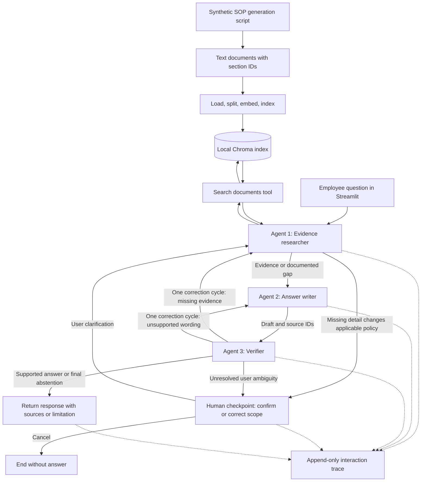

# Enterprise policy question answering design

Status: local implementation completed and verified. This document preserves the reviewed design; see `REQUIREMENT_CHECK.md` for actual completion/deferred status, `README.md` for running the app, and `results/error_analysis.md` for measured outcomes.

Implementation refinements: CPU MiniLM uses Chroma's ONNX implementation; source IDs are rendered in the Sources panel instead of requiring inline brackets; scope checks and non-null clarification objects improve local-model reliability. Semantic scoring was inspected by the coding assistant, not independently by a human. The evaluation is question-level with some shared policy facts. Original held-out scores are preserved after a small finalization bug was fixed and regression-tested. No production or submission deliverables were added.

Sources: `REQUIREMENTS.md`, cross-checked against `Avathon_AI_Hiring_Challenge.docx`. Scope: Track A, Scenario S2. Submission preparation is deferred at your request, but its explicit requirements remain recorded below.

## 1. Explicit requirements and evaluation checklist

The numbered items below are requirements from the brief, grouped where they describe one deliverable. Design choices later in this document are not additional assessment requirements.

1. Choose one scenario and exactly one track; justify the combination and define a meaningful enterprise business problem. Selected: Track A and S2.
2. Address unstructured enterprise documents through extraction, classification, summarization, **or** question answering. All four capabilities are not required.
3. Implement collaborating autonomous agents, with at least three distinct, well-defined roles.
4. Demonstrate genuine role separation and observable inter-agent communication; one long LLM prompt does not qualify.
5. Use an orchestration framework, or strongly justify a custom orchestrator.
6. Define an agent message schema and document its types and example payloads.
7. Have at least one agent use an external tool; retrieval qualifies.
8. Include at least one human checkpoint before proceeding, allowing review, override, or approval.
9. Provide full interaction traces for at least two end-to-end scenarios: success and an edge case or failure.
10. Explain why agentic AI is appropriate instead of a single-LLM pipeline or classical ML.
11. Explain the framework choice, alternatives, and accepted trade-offs.
12. Explain how agent roles map to the problem and why this number/grouping.
13. Identify silent failure modes and explain detection or mitigation.
14. Source the data; document its source and scenario suitability. Open-source and synthetic data are both allowed.
15. If synthetic data is used, provide its generation script, distributions, assumptions, and limitations relative to real data.
16. Supply a public or private GitHub repository; if private, grant access to the reviewer handle supplied by the recruiter.
17. Include a README with the problem, domain, data source, track, setup, and end-to-end reproduction instructions.
18. Provide `requirements.txt` or `environment.yaml` with pinned versions and state the Python version.
19. Organize code, data or generation script, results, and write-up clearly.
20. Maintain iterative development history; a single bulk commit is flagged as a concern.
21. Provide a narrated screen recording of at most five minutes.
22. In that recording, cover problem/approach, algorithm decisions and rejected alternatives, results and failures, and what would change with more time. Focus on reasoning and trade-offs, not line-by-line code narration. The brief gives a 1 / 2 / 1.5 / 0.5 minute structure.
23. Host the video on Google Drive, Dropbox, or unlisted YouTube and include its link in the README.
24. Provide a one-to-two-page PDF write-up, minimum 11pt font, with name and track letter at the top.
25. Write-up section 1: problem, domain, meaningful AI opportunity, and track suitability.
26. Write-up section 2: approach and algorithm decisions; name and reject at least one alternative for every major algorithmic choice, including items 10–13.
27. Write-up section 3: key metrics on a held-out evaluation set, failures, and their causes.
28. Write-up section 4: one concrete production consideration and one limitation needing attention before deployment.
29. Complete within 48 hours of receipt, with no extension; raise requirement questions with the recruiter within the first four hours.
30. Submit GitHub URL, video URL, and write-up PDF through the recruiter-provided link. Actual link and private-reviewer handle are not in the brief.
31. Justify tooling choices. Local compute, open-source libraries, free tiers, and external LLM APIs are permitted for Track A; GPU spending is not required.

### Evaluation criteria

32. **Problem framing and approach rationale — 25%:** clear business problem, AI opportunity, explicit track justification, and domain understanding.
33. **Algorithm selection and alternative analysis — 30%:** justified major choices, named alternatives, comparisons, and clear rejection reasoning. This is the highest-weighted dimension.
34. **Technical execution and correctness — 25%:** sound algorithms, clean structure, reproducibility, and technical depth.
35. **Results, evaluation, and honest error analysis — 10%:** suitable metrics, no test leakage, appropriate baselines, and understanding failures.
36. **Communication and clarity — 10%:** concise, precise writing and a walkthrough that communicates decisions to technical stakeholders.
37. **Track A strong-submission signals, not extra mandatory features:** observability; cost and latency awareness; deployment, monitoring, and updates without downtime. Address these briefly in reasoning rather than building production infrastructure.

The brief prioritizes reasoning over raw accuracy and does not give a pass score. Track A specifies no evaluation-set size, mandatory metric, specific framework, or UI. Track D requirements such as hybrid retrieval and 20 QA pairs do not apply. Post-submission interview and feedback arrangements are logistics, not implementation requirements.

## 2. Proposed problem and scope

Employees need answers to procedural questions spread across internal policies and SOPs. An incorrect deadline, approval rule, or eligibility statement can lead to the wrong action. The system retrieves evidence and, when applicability depends on missing user details, pauses for the requester to review and confirm or correct the intended scope. It then drafts and verifies a supported answer. When the documents do not support an answer, it reports the gap instead of using general knowledge.

Approved by you: synthetic company SOPs/policies, employee Q&A, reuse of the existing Streamlit interface where practical, and Ollama. Streamlit replaces the previously proposed command-line demo. The human checkpoint is conditional clarification by the requester, replacing approval of every final answer. No separate reviewer is needed.

The local implementation will support one question per run, with at most one clarification exchange, over a fixed English text corpus. It will use exactly three agents, one retrieval tool, one bounded correction cycle, structured traces, and a small held-out evaluation. The existing Streamlit chat layout will display clarification requests and accept the user's reply.

Reuse a minimal local Streamlit application. No separate authentication service, cloud deployment, OCR, Wikipedia fallback, fine-tuning, or hybrid-search benchmark is needed for this scope.

## 3. Architecture



LangGraph controls transitions and shared state. All three agents use the same local model but have separate prompts, structured outputs, and decision authority. Sharing model weights does not mean sharing one undifferentiated agent role.

### Agent responsibilities

| Agent | Inputs | Autonomous decisions | Output |
|---|---|---|---|
| Evidence researcher | Question, user clarification, and any verifier feedback | Select search query; call retrieval; judge relevance; identify missing evidence or ask for missing user details | Evidence bundle with source IDs, excerpts, and gaps, or clarification request |
| Answer writer | Question, evidence, and any correction request | Select supported claims; synthesize a concise answer; abstain when evidence is insufficient | Draft, cited source IDs, and unresolved points |
| Verifier | Original question, confirmed scope, full evidence bundle, and draft | Accept, request targeted retrieval, request a rewrite, flag unresolved user ambiguity, or require abstention | Verdict and specific feedback |

These are decision-making agents rather than labels on fixed text transformations. A verifier message changes what the researcher searches or what the writer revises. The trace exposes those decisions and subsequent actions.

Three is the required minimum and maps directly to gathering evidence, producing an answer, and checking it. Combining writer and verifier removes the separate review role; adding a manager would add calls without a distinct necessary responsibility. The orchestrator itself is deterministic, not a fourth agent.

### Execution boundaries

- Researcher: at most three search calls over the entire run: initial retrieval, retrieval after clarification if needed, and one verifier-directed retry. No arbitrary tools.
- Verifier: at most one correction request, routed to researcher or writer. A remaining problem becomes a deterministic abstention carrying the unresolved issue.
- Invalid structured output: one repair attempt per call, then an explicit run error. Tool/runtime errors remain errors, not evidence that an answer does not exist.
- Human checkpoint: only when a missing user detail materially changes the answer. Show the interpretation, relevant policy distinction, and one targeted question with options where useful. The user confirms or overrides the scope before execution proceeds; silence is not confirmation. Store their reply in graph state and rerun retrieval with the clarified question. Limit the entire run to one clarification exchange; if ambiguity remains, explain that a supported answer cannot yet be given. Cancellation ends the run.
- A missing policy fact is not a missing user detail. Ask users about their circumstances (for example, expense type), not to supply or certify company policy. Clear questions proceed without interruption; absent documentary evidence leads to abstention after the bounded retrieval effort.
- Use a LangGraph interrupt and in-memory checkpointer for the local session. Resume with the same run/thread ID. Restart recovery is not part of this minimal demo. Keep final release separate from the interrupt node to avoid repeating side effects on resume.

The interrupt design follows the [official LangGraph documentation](https://docs.langchain.com/oss/python/langgraph/interrupts).

Example: the user asks, "When should I submit my claim?" Retrieved sections distinguish travel expenses from medical reimbursement. The researcher pauses: "Do you mean a travel expense claim or medical reimbursement?" The user selects travel expenses, the graph resumes retrieval for that scope, and the writer/verifier produce the answer with its source. This is the requirement's review/override decision point: the user controls which interpretation the system acts on, rather than checking answer correctness. Demonstrate this pause explicitly in an end-to-end trace.

## 4. Reuse from pdf-chatbot

Repository access was confirmed on 26 October 2026. Inspected revision: `1e6861bfad3108b5b0c46f181544e6878bccc2e2`. A reference checkout is available under `reference/pdf-chatbot/`. Its code has been inspected, not executed or validated for this assessment.

| Existing component | Decision |
|---|---|
| `rag/embedder.py`, `rag/chroma_store.py` | Adapt the local embedding and Chroma access into small standalone modules. |
| `api/upload.py` loading/splitting logic | Extract text loading and metadata preservation; avoid its HTTP/auth/database dependencies. |
| `core/llm_client.py` | Adapt Ollama initialization; keep only the provider needed here. |
| `rag/retrieval.py` | Reuse retrieval concepts, but separate the search tool from answer generation. Its current combined function is not the agent graph. |
| Citation and trace structures | Reuse provenance ideas; extend to complete messages, tools, decisions, and human events. |
| Existing chat flow and Wikipedia agent | Do not carry over. Public knowledge cannot establish company policy. |
| `apps/web/rag_ui/layout/chat_page.py` | Reuse chat messages, input, source expander, and trace expander; adapt rendering for clarification events and final responses. |
| `apps/web/rag_ui/state.py` | Adapt session-state initialization and unique run IDs; store ordered messages and pending clarification instead of only question/answer tuples. |
| `apps/web/rag_ui/layout/sidebar.py` | Reuse the basic sidebar with the fixed corpus list and New Question control. Omit login/logout, arbitrary uploads, and past-conversation switching for this demo. |
| `apps/web/rag_ui/app.py`, `api_client.py` | Adapt the app shell; replace auth-gated HTTP calls with direct calls to the local graph service. |
| Auth, Docker, OCR, RAGAS templates | Leave outside the assessment implementation. |

The source uses an MIT license; retain attribution and its license notice for copied code. Its dependency ranges are not pinned versions, so they cannot serve unchanged as the assessment dependency file. Preprocessing also needs care: preserve policy symbols and wording rather than copying aggressive text cleanup.

### Streamlit integration

The existing UI is reusable but is not plug-and-play: it currently requires authentication, calls FastAPI, assumes every backend response contains a final answer, and stores completed question/answer pairs. Adapt those boundaries rather than bringing the whole backend into this assessment.

Use this local flow: **Streamlit → graph service → LangGraph agents → Ollama and retrieval**. Evaluation scripts call the same graph service without the UI; a separate interactive CLI is unnecessary.

- Keep the familiar chat input, assistant messages, source excerpts, and expandable trace. Replace general-topic suggestions with policy questions and show the fixed corpus in the sidebar.
- When LangGraph pauses, display its clarification as an assistant message. While a clarification is pending, route the next submitted reply to resume the same graph run rather than starting a new question. Provide Cancel; New Question cancels any pending run and creates a fresh ID.
- Retain the session's graph/checkpointer, run ID, ordered messages, pending interrupt, and final result across normal Streamlit reruns. Invoke/resume only on explicit submission events; rendering must not trigger duplicate model calls or duplicate trace events.
- Keep a graph/checkpointer per browser session so users do not share execution state. The document index can remain read-only and shared. A browser reload or process restart may lose the session; persistent recovery remains out of scope.
- Show a final answer only after the graph finishes. Keep sources and trace available after rerenders. The trace remains a simple expander, not a new monitoring dashboard.

Verify one clear question, one clarification/resume path, cancellation, and rerender behavior during implementation. The UI is a user-requested presentation choice, not an additional assessment requirement.

## 5. Local model and algorithm choices

Hardware observed: AMD Ryzen 9 8945HS, approximately 31.3 GiB usable system RAM, NVIDIA RTX 4060 Laptop GPU with approximately 8 GiB VRAM.

Installed models include `qwen3.5:4b`, `qwen3.5:9b`, `llama3.2:3b`, and `llama3.2:1b`. Start with the **installed `qwen3.5:4b`** for all agents. Its local file is about 3.39 GB and reports tool support. That leaves more memory headroom than the installed 9B model, whose file is about 6.59 GB. File size is not runtime memory usage; actual fit and latency still require a smoke test.

Use sequential agent calls, a starting context budget of 4,096 tokens, short evidence bundles, and bounded output. Disable thinking if supported by the installed integration and validated on development cases. Record the installed model digest rather than assuming a mutable tag identifies identical weights. The installed 4B digest is `2a654d98e6fba55d452b7043684e9b57a947e393bbffa62485a7aac05ee4eefd`.

This is a suitability recommendation, not a claim that 4B is the best-performing model. If it fails basic tool/schema/citation checks on development examples, try the already-installed 9B model and measure memory and latency before freezing the choice. No model has been downloaded or benchmarked in this design phase. The [Ollama model page](https://ollama.com/library/qwen3.5:4b) confirms the model family supports tools; its current registry artifact differs from the installed snapshot, so do not silently refresh it.

| Choice | Alternative and reason not selected | Trade-off |
|---|---|---|
| Three-agent evidence/writer/verifier graph | Single-pass RAG is sufficient for simple lookup. Separate roles make evidence repair and draft checking explicit in ambiguous procedural questions. Classical ML classification cannot directly answer open-ended procedural questions from passages. | More latency and correlated model errors; superiority must be tested, not assumed. Clarification is also possible with one agent and is not by itself proof that multiple agents are necessary. |
| LangGraph | CrewAI is a valid alternative; explicit state transitions suit this small bounded loop. A custom loop would require hand-building the pause/resume and transition machinery. | Additional framework dependency and state-management code. |
| Installed Qwen 3.5 4B in Ollama | 9B has less GPU headroom; hosted inference contradicts the selected local approach; the smaller installed Llama models remain possible fallbacks but are not presumed adequate without checks. | Local verification quality may be weaker; measure on development cases. |
| Existing MiniLM embedding configuration on CPU | A hosted embedding service adds an unnecessary external dependency for a small local corpus. | Semantic matches can miss exact procedural distinctions. |
| Local Chroma | FAISS is viable but would require separate metadata/persistence handling; Chroma is already present in reusable code. | Extra package overhead. |
| Section-aware chunks and dense top-3 retrieval | Whole-document prompts obscure evidence selection; hybrid search and reranking introduce more components without a Track A requirement. | Retrieval misses remain possible; inspect failures before changing the approach. |
| Human-checked evaluation labels | An LLM-only judge could reproduce the verifier's mistakes. | Small manual scoring effort; report explicit scoring rules. |

Use one policy section per chunk where possible; split long sections at paragraph boundaries. Cap chunks to the embedding model's actual token limit so text is not silently truncated. Preserve document and section IDs. The original 1,500-character splitter is only a reference, not an accepted final parameter.

## 6. Agent message schema

Implement this contract with Pydantic types and validate every transition. Graph state holds the original question, clarified scope, messages, evidence, draft, verdict, correction count, clarification count, and user response. A clarification invalidates any prior draft/verdict before retrieval resumes.

| Field | Type | Meaning |
|---|---|---|
| `run_id` | `str` | One end-to-end execution |
| `message_id` | `str` | Unique event ID |
| `sequence` | `int` | Ordering within the run |
| `sender`, `recipient` | enum | `user`, `researcher`, `writer`, `verifier`, `human`, `orchestrator`, `retrieval_tool` |
| `kind` | enum | `question`, `tool_call`, `tool_result`, `evidence`, `draft`, `review`, `clarification_request`, `clarification_response`, `final`, `error` |
| `payload` | discriminated union | Typed payload selected by `kind` |
| `timestamp` | ISO datetime | Event time |

Payload types:

- `Question`: `text: str`.
- `ToolCall`: `name: Literal['search_documents']`, `query: str`, `k: int` constrained to 1–3.
- `ToolResult`: `evidence: list[Evidence]`; each `Evidence` has `chunk_id`, `document_id`, `section_id`, and `text`, all strings.
- `EvidenceBundle`: `evidence: list[Evidence]`, `gaps: list[str]`.
- `Draft`: `answer: str`, `source_ids: list[str]`, `abstain: bool`.
- `Review`: `verdict: Literal['accept','retrieve','revise','clarify','abstain']`, `feedback: str`, `source_ids: list[str]`.
- `ClarificationRequest`: `interpretation: str`, `question: str`, `options: list[str]`, `source_ids: list[str]`. Example payload: `{"interpretation":"The claim type is unspecified.","question":"Do you mean travel expenses or medical reimbursement?","options":["Travel expenses","Medical reimbursement"],"source_ids":["expenses-travel","expenses-medical"]}`.
- `ClarificationResponse`: `action: Literal['confirm','correct','cancel']`, `text: str`. Example payload: `{"action":"correct","text":"I mean travel expenses."}`.
- `Final`: `status: Literal['answered','abstained','cancelled']`, `answer: str | None`, `source_ids: list[str]`.
- `Error`: `stage: str`, `code: str`, `message: str`.

Illustrative payloads, not execution results:

```json
{
  "run_id": "demo-001",
  "message_id": "m04",
  "sequence": 4,
  "sender": "researcher",
  "recipient": "writer",
  "kind": "evidence",
  "timestamp": "2026-10-26T12:00:00Z",
  "payload": {
    "evidence": [{"chunk_id": "expenses-2", "document_id": "expenses", "section_id": "2", "text": "Claims must be submitted within 30 calendar days."}],
    "gaps": []
  }
}
```

```json
{
  "run_id": "demo-001",
  "message_id": "m06",
  "sequence": 6,
  "sender": "verifier",
  "recipient": "writer",
  "kind": "review",
  "timestamp": "2026-10-26T12:00:02Z",
  "payload": {"verdict": "revise", "feedback": "The source says calendar days, not working days. Correct the draft.", "source_ids": ["expenses-2"]}
}
```

Persist the complete messages, tool arguments/results, relevant model inputs/outputs, prompts or prompt versions, routing decisions, errors, human decision, final output, model digest, token counts when available, and elapsed times in JSONL. This is an interaction trace, not a request to expose hidden model reasoning. Trace-write failures should be visible and block a supposedly complete demonstration.

## 7. Data and evaluation

Proposed size is a design choice, not an assessment minimum: generate four short text policies covering expenses, leave requests, access requests, and incident reporting. Use a deterministic script with fixed templates, explicit policy values, and section IDs. No LLM-generated company facts are needed.

Document the full fixed value table and sampling method: there is no random population distribution; each template is generated once with specified values. These policies are invented and are not real employer rules. They omit real-world document noise, complicated exceptions, tables, and contradictory versions.

Prepare four development questions and eight held-out questions: three direct answerable questions, two requiring evidence from multiple sections, one ambiguous question resolved by clarification, and two unanswerable questions. Include travel and medical claim sections in the expenses document to support a real scope distinction. Separate questions and evidence targets from development cases; do not merely paraphrase the same development fact. Freeze the held-out labels before tuning. The corpus is indexed for both sets; held-out questions and gold answers are never supplied to agents except the question under evaluation.

Each evaluation record includes question, expected answer facts or abstention, source IDs, and scoring notes. Manually review gold labels against the policies. The limited synthetic sample supports only a small demonstration, not a production-quality accuracy claim.

Report:

- **Task correctness:** number correct / 8. An answer is correct only if required facts are present and no contradictory or unsupported factual claim is added; an unanswerable case must abstain.
- **Citation support:** supported factual claims / all factual claims in attempted answers, manually checked against cited text. Report counts and mark the metric not applicable when there are no claims.
- **Abstention correctness:** correct abstentions / 2 unanswerable cases; also report unnecessary abstentions on the six answerable cases.

Use one simple baseline: the same model and corpus with one fixed retrieval call and one answer-generation call, without verifier/retry. Evaluate on the same frozen questions and rubric. This small comparison addresses the rubric's baseline and agentic-rationale concerns; it is not a separate Track D project. Record latency and model-call counts for both without building a benchmark suite.

For the ambiguous evaluation case, predefine a user reply containing only the missing circumstance, not the policy answer. Score the final answer against that scope and separately record whether the system requested clarification before answering. For a fair answer-quality comparison, give the baseline the same clarified scope and label this condition; assess interruption behavior separately. Automated replay of that reply is evaluation plumbing, not evidence of a real human checkpoint. Capture a real user clarification in the demonstration trace. Preserve failures; do not tune on the held-out set after observing its scores.

### Required demonstration traces

1. **Success:** ask the travel-expense submission deadline explicitly. Researcher obtains the relevant section; writer answers with a citation; verifier accepts; final answer is returned without interruption.
2. **Ambiguous-request edge case:** ask "When should I submit my claim?" The researcher finds different policy sections for travel and medical claims, pauses for the user to review/select the intended scope, and resumes after the user specifies travel expenses. Writer and verifier produce a supported answer. Save the question, interrupt, actual user response, subsequent tool calls, agent messages, and final answer. This demonstrates both the edge-case trace and the human checkpoint. Missing-policy abstention remains covered in the held-out evaluation.

These are intended demonstrations, not guaranteed model outcomes. If actual behavior differs, keep the trace and explain the failure. Focused automated tests will prove that clarification pauses execution until a reply, cancellation ends the run, clear requests do not require clarification, and correction/clarification loops terminate.

## 8. Silent failures and production limitations

| Risk | Minimal detection or mitigation |
|---|---|
| Irrelevant retrieval looks like evidence | Researcher evaluates relevance; verifier checks claims against actual excerpts; unanswered questions are in evaluation. |
| Fabricated citations or altered numbers | Validate source IDs against retrieved records; verifier and manual evaluation check wording and values. |
| Writer and verifier share the same mistaken interpretation | Separate role prompts and explicit claim/evidence review; report that same-model verification is not independent proof. |
| Invalid or invented tool calls | Allow only the retrieval tool with validated arguments; trace errors explicitly. |
| Document instructions influence agents | Treat retrieved text as data and restrict tools; this reduces risk but does not establish complete prompt-injection protection. |
| Missing text or embedding truncation | Validate nonempty sections, retain source IDs, and enforce the embedding input limit. |
| Guessing a missing user detail or repeated questioning | Conditional clarification gate, no silent default, one clarification exchange, and focused flow tests. |
| Unbounded correction | Explicit correction count and retrieval limits. |

One concrete production consideration: enterprise document access must be enforced at retrieval time and reflected in trace access. The local single-user prototype does not implement enterprise authorization.

For the brief's production-thinking signal, describe a service wrapping the graph, durable checkpoints, failure/latency monitoring, and versioned prompts/indexes switched only after evaluation so in-flight runs keep their version. Document this; do not build it now.

Cost/latency trade-off: one locally loaded model used sequentially, short retrieved context, and bounded retries reduce memory and call count. The independent verifier still costs an additional model call and does not guarantee correctness.

## 9. What would change with more time

Keep this as documentation, not current implementation scope:

- Evaluate on real, permissioned SOPs with exceptions and conflicting versions; the synthetic set is too simple to establish reliability.
- Compare the installed 9B model against 4B if quality is inadequate, measuring quality and latency together.
- Try keyword-plus-dense retrieval or reranking only if error analysis shows retrieval misses dominate.
- Add document access controls and durable clarification state before shared enterprise deployment.

## 10. Local implementation plan after design review

1. Confirm model tool/schema behavior on development examples; select tested dependency versions and Python 3.12 if available.
2. Adapt the small reusable modules, preserve attribution, and generate documents plus development/evaluation fixtures.
3. Implement typed messages, the three agents, bounded graph routes, and adapt the existing Streamlit UI for conditional clarification.
4. Add complete trace logging and focused tests for tool errors, invalid citations, bounded retries, and clarification/resume/cancellation.
5. Freeze configuration, run the baseline and held-out evaluation, then capture the two real end-to-end traces and honest error analysis.

Proposed files:

```text
DESIGN.md
README.md
requirements.txt
app.py                      # adapted Streamlit entry point
src/policy_qa/
  ui.py                     # reused chat/source/trace rendering
  service.py                # start/resume/cancel graph runs
  graph.py
  agents.py
  schemas.py
  retrieval.py
  llm.py
  traces.py
scripts/generate_data.py
scripts/evaluate.py
data/policies/
data/dev.jsonl
data/eval.jsonl
tests/
results/traces/
results/evaluation.json
results/error_analysis.md
write-up/                 # final PDF deferred
```

Develop through meaningful local commits once implementation begins. No publishing or submission work is requested now.

## 11. Requirement coverage and assumptions

Coverage below means **covered by this design**, not already implemented or passed.

| Checklist item | Coverage location or status |
|---|---|
| 1 | Section 2: Track A, S2, and business problem |
| 2 | Section 2: document question answering |
| 3 | Section 3: exactly three autonomous roles |
| 4 | Sections 3 and 6: decisions, feedback routes, visible messages |
| 5 | Sections 3 and 5: LangGraph |
| 6 | Section 6: types and example payloads |
| 7 | Section 3: researcher calls retrieval |
| 8 | Section 3: user reviews and confirms/overrides scope before resuming |
| 9 | Section 7: direct success and ambiguous-request edge-case trace plans |
| 10 | Section 5: agentic versus single-call/classical alternatives |
| 11 | Section 5: framework rationale and trade-off |
| 12 | Section 3: role grouping and agent count |
| 13 | Section 8: silent failures and mitigations |
| 14 | Section 7: scenario-relevant synthetic policies |
| 15 | Section 7: generation, fixed distributions, assumptions, realism gap |
| 16 | Deferred: final repository hosting/access |
| 17 | Section 10: planned README and reproduction workflow |
| 18 | Section 10: tested pins and Python version, not yet selected/installed |
| 19 | Section 10: proposed file layout |
| 20 | Section 10: meaningful local implementation commits planned |
| 21 | Deferred: recording, at most five minutes |
| 22 | Sections 5, 7, and 9 supply planned content; recording deferred |
| 23 | Deferred: video hosting and README link |
| 24 | Deferred: final PDF format and author heading |
| 25 | Section 2: problem/domain material |
| 26 | Sections 3, 5, and 8: decisions and alternatives |
| 27 | Section 7: held-out metrics and error analysis plan; no results yet |
| 28 | Section 8: access control and prototype limitations |
| 29 | Recorded in section 1; receipt time unknown, deadline not verified |
| 30 | Deferred at your request; recruiter link still needed later |
| 31 | Section 5: local tooling rationale |
| 32 | Section 2: framing and track suitability |
| 33 | Section 5: choice/alternative/trade-off table |
| 34 | Sections 6 and 10: contracts, reproduction, and focused checks planned |
| 35 | Section 7: frozen held-out set, baseline, manual scoring, honest failures |
| 36 | This design; concise final PDF and video still deferred |
| 37 | Sections 6 and 8: traceability, call/latency awareness, production discussion |

Confirmed decisions: synthetic SOPs/policies, employee Q&A, reuse of the local Streamlit UI, conditional clarification by the requester, LangGraph orchestration, and Ollama. Routine final-answer approval has been removed.

Assumptions proposed for review: English text documents; one user and one question per run with at most one clarification exchange; four policies, four development cases, and eight held-out cases; in-session clarification without restart recovery. These are implementation choices, not requirements from the brief. The checkpoint satisfies review/override by explicitly allowing the requester to control the interpretation before execution resumes; it does not ask the requester to validate policy correctness.

Remaining uncertainty: model suitability and dependency compatibility need actual execution checks. The brief does not define a pass threshold or a minimum held-out set for Track A. Receipt time and submission details are unknown and intentionally deferred. No assessment requirement was interpreted as requiring cloud services, three different models, or all four S2 capabilities.
