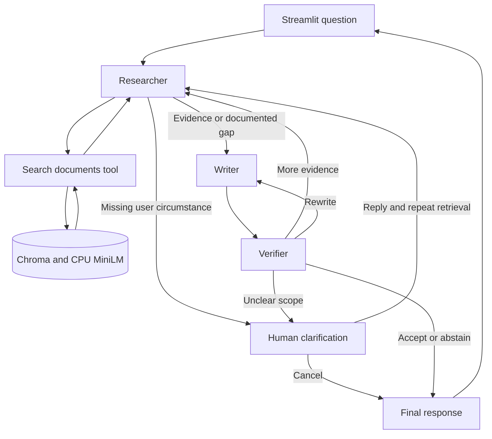

# Enterprise policy question answering: design

Track A — Agentic / Multi-Agent AI, Scenario S2 — Enterprise Documents. This document describes the current local implementation. Setup and reproduction commands are in [README.md](README.md); historical measurements and failures are in [results/error_analysis.md](results/error_analysis.md).

## Problem and scope

Employees need procedural answers from policies spread across expenses, leave, system access, and incident reporting. Incorrect deadlines, approvals, or eligibility rules can lead to the wrong action. The assistant retrieves policy evidence, asks about missing user circumstances when necessary, and returns an answer with citations or explains that it cannot answer.

The corpus contains four fictional English text policies and 11 sections. It is generated deterministically, without random sampling or LLM synthesis. Four development cases and eight held-out questions exercise direct answers, multi-section answers, clarification, and unsupported requests. Values, assumptions, and realism limits are documented in [data/README.md](data/README.md). This is a local assessment prototype; authentication, uploads, OCR, cloud hosting, and model training are outside its scope.

## Architecture and execution



LangGraph coordinates shared state. Branching nodes return `Command(update=..., goto=...)`; fixed transitions use edges. The orchestrator is deterministic and is not a fourth agent. All three roles share one local model, called sequentially with separate prompts and validated outputs.

| Role | Inputs | Decisions and output |
|---|---|---|
| Researcher | Question, confirmed user scope, and reviewer feedback | Selects a search query, calls retrieval, assesses relevance and gaps, and chooses writing or clarification |
| Writer | Question, scope, retrieved evidence, researcher assessment, and feedback | Produces a supported draft with source IDs or abstains |
| Verifier | Question, scope, evidence, and draft | Accepts, requests targeted retrieval or rewriting, asks for clarification, or requires abstention |

A normal successful path makes four model calls: search selection, research assessment, writing, and verification. Repair and clarification paths add calls. Feedback changes subsequent retrieval or drafting, and evidence/draft/review events record those handoffs.

### Human checkpoint

“When should I submit my claim?” can refer to travel or medical claims. The researcher can ask which applies, then pause with LangGraph `interrupt()`. A nonempty reply resumes the same run via `Command(resume=...)`; the user can also cancel. The user controls the interpretation, rather than approving the policy facts.

The clarification node records the reply after `interrupt()` returns so restarting that node on resume does not duplicate earlier effects. Replies accumulate in the scope; previous evidence, draft, assessment, and feedback are cleared before research restarts. Clear questions proceed without a checkpoint. Missing policy facts cause abstention rather than a request for the user to invent policy information.

### State and execution bounds

Shared state holds the question, confirmed scope, evidence, research assessment, draft, feedback, pending clarification, counters, and final response. Each new question receives a fresh run ID and in-memory checkpointer. The UI preserves chat history, but earlier questions are not passed as conversational context to a new run.

Limits are defined in `src/policy_qa/limits.py`:

| Limit | Current value |
|---|---:|
| Searches across a run | 3 |
| Correction cycles across a run | 3 |
| Clarification exchanges across a run | 3 |
| Output repairs after an initial model attempt | 3 |
| Graph steps per invocation | 40 |

Search, correction, and clarification counters persist across resumes. The search budget may be exhausted before the other budgets. Output repair adds validation feedback to the next model attempt; it is distinct from retrying an entire graph node. Runtime errors are recorded as errors, not as evidence that the policy lacks an answer.

## Model, retrieval, and interface

`ChatOllama.with_structured_output()` requests JSON-schema outputs, and `bind_tools()` supplies the single allowed `search_documents` tool. Python validates and executes the chosen tool call. The official Ollama Python client checks that the selected model is installed and records its digest.

Defaults: `qwen3.5:4b`, a 4,096-token context, 700-token output cap, temperature 0, seed 42, thinking disabled, and a ten-minute keep-alive. The same model is reused across roles. Repeatability remains dependent on runtime and hardware. Override the model and server before launch if needed:

```powershell
$env:POLICY_MODEL = 'qwen3.5:4b'
$env:OLLAMA_HOST = 'http://127.0.0.1:11434'
```

Policy sections retain stable IDs such as `expenses/travel-deadline`. MiniLM ONNX embeddings run on the CPU; Chroma stores a persistent cosine-similarity index under `.runtime/`. Collections are keyed by the corpus hash. Searches return at most three sections. Each section is checked against MiniLM's 256-token input limit; oversized sections are rejected rather than silently accepted as complete evidence.

Streamlit calls the graph service directly. A pending clarification routes the next message to the same run; after completion, the next question creates a new run. Numbered citations show only the source file name and section title on hover. The UI does not show raw traces, source paragraphs, or internal fallback diagnostics. Full details remain in logs and JSONL traces.

## Decisions, alternatives, and trade-offs

| Choice | Alternative and reason not selected | Trade-off |
|---|---|---|
| Three separate agent roles | Single-pass RAG is sufficient for simple lookups; separate roles make evidence selection, clarification, and review explicit for this Track A demonstration. Classical classification alone cannot synthesize open-ended procedural answers from evidence. | More calls and latency; separate roles do not guarantee better answer quality |
| Exactly three agents | Combining writer and verifier removes separate review; a manager adds no distinct necessary responsibility. | Shared model weights can produce correlated errors |
| LangGraph | CrewAI is viable; explicit state updates and branching fit this bounded workflow. A custom loop would need its own checkpoint and resume machinery. | Additional framework and state complexity |
| Local Qwen 3.5 4B in Ollama | The installed 9B variant leaves less memory headroom on the development laptop's 8 GB GPU. Hosted inference adds an external service to the selected local approach. | Small-model tool use and verification can be unreliable; local does not imply best quality |
| CPU MiniLM and Chroma | Hosted embeddings add an external dependency; FAISS would need separate metadata and persistence handling. | CPU avoids GPU competition, but semantic matches can miss precise policy distinctions |
| Section-level, dense top-3 retrieval | Whole-document prompts make evidence selection less explicit. Hybrid search and reranking add components before retrieval errors justify them. | Relevant sections can be missed; long sections need preprocessing |
| Streamlit with direct graph calls | A separate FastAPI service adds an unnecessary boundary for a local demonstration. | No service-layer authentication or independent deployment |
| Explicitly reviewed evaluation labels | An LLM-only judge may repeat the agents' mistakes. | Review was by the coding assistant, not an independent human or blinded evaluator |

Prompts are maintained in `src/policy_qa/prompts.py`. Shared evidence rules separate policy facts from user instructions, retrieved instructions, and reviewer feedback. Role prompts distinguish missing user scope from absent policy facts and constrain claims and citations. Prompts guide semantic behavior; code enforces output contracts and execution limits.

## Agent message contract

The implementation is defined in `src/policy_qa/schemas.py`. Each JSONL event has the following envelope, validated by `Event`:

| Field | Type and purpose |
|---|---|
| `run_id` | String identifying the end-to-end question run |
| `message_id`, `sequence` | String event ID and integer ordering within the run |
| `timestamp` | ISO-8601 UTC timestamp string |
| `sender`, `recipient` | Strings naming participants |
| `kind` | Enumerated event type listed below |
| `payload` | Dictionary containing the event data |

Participants are `user`, `human`, `researcher`, `writer`, `verifier`, `retrieval_tool`, and `orchestrator`. Decision payloads are validated with their Pydantic models before use. The event payload itself is a dictionary, not a discriminated union.

| Event kind | Payload contract |
|---|---|
| `question` | `{text: str}` |
| `tool_call` | `Search(query: str, k: int[1..3])`; only `search_documents` is permitted |
| `tool_result` | `{evidence: list[Evidence]}` |
| `evidence` | `{assessment: Research, evidence: list[Evidence]}` |
| `draft` | `Draft(answer: str, source_ids: list[str], abstain: bool)` |
| `review` | `Review(scope_check: str, verdict: accept/retrieve/revise/clarify/abstain, feedback: str, source_ids: list[str], clarification: Clarification)`; the deterministic citation guard emits verdict, feedback, and IDs |
| `clarification_request` | `Clarification(interpretation: str, question: str, options: list[str])` |
| `clarification_response` | `HumanReply(action: confirm/correct/cancel, text: str)`; non-cancel replies must be nonempty |
| `final` | `Final(status: answered/abstained/cancelled, answer: str, source_ids: list[str])` |
| `error` | `{stage: str, code: str, message: str}` for graph errors |
| `model_call` | Model request, native LangChain response, elapsed seconds, and validation errors when present |
| `metadata` | Model/digest, corpus hash, prompt version, limits, and reply actor; separate metadata events record internal abstention reasons |

`Evidence` contains string fields `chunk_id`, `document_id`, `section_id`, and `text`. `Research` contains `scope_check: str`, `action: write/clarify`, `source_ids: list[str]`, `gaps: list[str]`, and `clarification: Clarification`.

Structured model outputs always contain a clarification object because the local model did not reliably populate a nullable form. For other decisions, its question is `Not required`, with empty interpretation/options; it is not displayed. Scope checks are short decision summaries, not hidden reasoning transcripts.

Example researcher-to-writer payload:

```json
{
  "assessment": {
    "scope_check": "The user explicitly asks about travel expenses.",
    "action": "write",
    "source_ids": ["expenses/travel-deadline"],
    "gaps": [],
    "clarification": {"interpretation": "", "question": "Not required", "options": []}
  },
  "evidence": [{
    "chunk_id": "expenses/travel-deadline",
    "document_id": "expenses",
    "section_id": "travel-deadline",
    "text": "Travel expense claims\nEmployees must submit travel expense claims within 30 calendar days after returning from the trip."
  }]
}
```

Example verifier-to-writer payload:

```json
{
  "scope_check": "Travel expense claim is confirmed.",
  "verdict": "revise",
  "feedback": "The draft says working days; the source specifies calendar days.",
  "source_ids": ["expenses/travel-deadline"],
  "clarification": {"interpretation": "", "question": "Not required", "options": []}
}
```

These are schema examples, not recorded execution results. Actual events are in `results/traces/`. Inter-agent evidence, draft, and review events expose the handoffs; self-addressed model-call events separately record model inputs and outputs. Native responses contain `tool_calls`, `usage_metadata`, and `response_metadata`; older frozen traces retain their original response fields. Traces are created without overwriting previous runs, and trace-write errors remain visible failures.

## Evaluation and evidence

The evaluation runs the agent workflow on eight held-out questions. For the ambiguous case, a predefined reply supplies the missing user circumstance after clarification. Automated replies are labelled `simulated_fixture`; they are not evidence of human participation. Expected facts and gold source IDs are used for scoring, not sent to agents.

Scoring checks completeness and unsupported extra assertions, claim support against the actual cited excerpts, correct abstention on two unsupported requests, and unnecessary abstention on six answerable ones. Development and evaluation cases share some policy facts, so this is a question-level holdout rather than a disjoint-document or disjoint-fact test.

The frozen evaluation recorded 7/8 correct responses, with correct abstention on 2/2 unsupported cases. The graph's failure was an unsupported process assertion copied from reviewer feedback into a final abstention. Finalization was subsequently fixed; the original score is preserved. Saved labels were inspected by the coding assistant, not an independent human. Timing covers one local run with simulated replies and excludes real human waiting and initial downloads.

Those results describe the earlier evaluated implementation, prompts, client, and one-correction/one-clarification/one-repair limits. Current prompt version 2, ChatOllama integration, larger budgets, routing, and UI changes are not a new held-out evaluation. Automated tests use fake agents, mocked model transport, and Streamlit's test runner; they do not establish current live-model answer quality.

The two required demonstration traces are linked in [error analysis](results/error_analysis.md):

- Success: [results/traces/success.jsonl](results/traces/success.jsonl).
- Ambiguous request with an actual human reply: [results/traces/clarification.jsonl](results/traces/clarification.jsonl).

## Failure handling and production limits

| Risk | Current mitigation and remaining limitation |
|---|---|
| Irrelevant retrieval looks authoritative | Researcher assesses relevance and verifier checks support; neither guarantees correctness |
| Invented citations | Model schemas constrain IDs to retrieved sections; application validation rejects unknown IDs; the graph checks inline citations and requires sources for attempted answers |
| Reviewer feedback becomes an unsupported answer | Deterministic fallback text keeps internal diagnostics in traces rather than appending them to the answer |
| Guessed user scope or unbounded loops | Conditional human clarification, no inference from silence, explicit counters, and a graph step limit |
| Malformed model output or tool call | Validated contracts and bounded repair; an invalid or unsupported tool cannot execute |
| Document instructions override evidence rules | Prompts treat documents as data and tools are restricted; prompt-injection resistance is not established |
| Embedding truncation | Nonempty corpus and section-token-limit checks; real long documents need additional preprocessing |
| Shared model mistakes | Distinct prompts and a review step, with acknowledged correlated errors |
| Lost or duplicated execution state | Session-held runs and in-memory checkpoints prevent duplicate calls on normal rerenders; restart recovery is not implemented |

Before shared enterprise use, enforce document access permissions during retrieval and restrict access to full traces. Add durable checkpoints, latency/failure monitoring, and evaluated prompt/index versions so updates do not silently change an in-flight run. Synthetic policies do not represent scans, conflicts, exceptions, or real corpus scale.

With more time, evaluate real permissioned documents and independently reviewed labels; compare a stronger model if error analysis justifies it; compare hybrid retrieval or reranking if evidence misses dominate. Assess whether the additional agent calls provide enough value to justify their latency and complexity.
