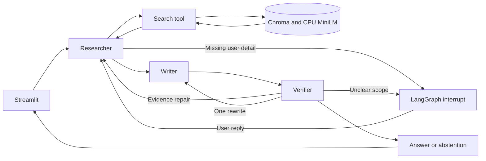

# Enterprise policy question answering

Track A — Agentic / Multi-Agent AI. Scenario S2 — Gen AI for Enterprise Documents.

Employees ask procedural questions across company policies. Three agents gather evidence, draft an answer, and verify it. When the applicable rule depends on a missing user detail, LangGraph pauses for clarification and resumes after the requester responds. Clear questions proceed directly; unsupported questions should abstain.

This is a local assessment prototype, using four explicitly synthetic policy documents. It does not represent a deployed enterprise system.

## Run locally

Tested Python: **3.12.10**, Windows, Ollama **0.34.4**, installed `qwen3.5:4b` Q4_K_M. All Python dependencies are pinned in `requirements.txt`.

PowerShell, from this repository:

```powershell
py -3.12 -m venv .venv
.venv\Scripts\python.exe -m pip install -r requirements.txt
.venv\Scripts\python.exe scripts/generate_data.py
.venv\Scripts\python.exe -m streamlit run app.py
```

Start Ollama before asking a question. It must expose `http://127.0.0.1:11434` and have `qwen3.5:4b` installed. If it is missing, obtain it through Ollama (`ollama pull qwen3.5:4b`); record its digest because current tags may differ from the tested weights. No external LLM API or key is required. The first index creation downloads approximately 79 MB of MiniLM ONNX weights into `.runtime/embeddings`; subsequent runs use the local cache.

Open the Streamlit address shown in the terminal (normally `http://127.0.0.1:8501`). Ask a question, answer a clarification if requested, and inspect Sources and Agent interaction trace. New question starts a separate run and cancels any pending clarification.

Optional configuration before launching:

```powershell
$env:POLICY_MODEL = 'qwen3.5:4b'
$env:OLLAMA_HOST = 'http://127.0.0.1:11434'
```

The same local model is reused sequentially for all agents. It is not loaded three times. The execution context is 4,096 tokens, temperature 0, seed 42, thinking disabled, output cap 700 tokens. Repeatability is bounded by model/runtime/hardware behavior, not guaranteed bit-for-bit.

## Architecture and choices



- **Agentic choice:** simple lookup could use one RAG call. This design separates evidence decisions, drafting, and verification, allowing targeted repair and human clarification. It is not assumed to outperform the baseline. Classical classification does not directly produce open-ended evidence-grounded procedural answers.
- **LangGraph:** explicit conditional transitions and pause/resume fit this bounded workflow. CrewAI is a reasonable alternative; a custom orchestrator would require implementing the checkpoint behavior ourselves. Trade-off: extra framework/state complexity.
- **Three agents:** the required minimum maps to three responsibilities. A manager agent adds no necessary role; combining writer and verifier removes separate review. Shared model weights mean their errors can be correlated.
- **Retrieval:** section-level chunks preserve rules and provenance; each section must fit MiniLM's 256-token input limit. CPU MiniLM avoids GPU competition. Dense cosine top-3 search in local Chroma reuses existing project patterns. FAISS would need separate persistence/metadata handling; hybrid search/reranking is deferred until retrieval errors justify it.
- **Interface:** adapted Streamlit chat, Sources, and trace rendering from the existing MIT-licensed pdf-chatbot. Calls the graph directly, without a separate API, authentication service, or SSE.
- **Model:** 4B fits the local memory budget. The installed 9B also missed the early clarification case and added latency; explicit scope assessment and a non-null clarification schema resolved that development issue. No claim of universal model superiority is made.

See `DESIGN.md` for alternatives and scope, `docs/messages.md` for message types and example payloads, and `THIRD_PARTY_NOTICES.md` for exact reuse provenance.

## Data and reproduction

`scripts/generate_data.py` creates four fictional policies, 11 sections, four development questions, and eight held-out questions. `data/README.md` documents sources, fixed distributions, assumptions, and realism limitations. No model training is performed.

```powershell
# Focused tests (no Ollama calls):
.venv\Scripts\python.exe -m pytest -q

# Development checks:
.venv\Scripts\python.exe scripts/run_cases.py --split dev

# Frozen held-out runs and same-model single-pass baseline:
.venv\Scripts\python.exe scripts/run_cases.py --split eval
.venv\Scripts\python.exe scripts/run_cases.py --split eval --baseline
```

These commands save timestamped results and complete JSONL traces. `run_cases.py` marks automated user replies as `simulated_fixture`; they are not claimed as real human participation. For the ambiguous baseline case, the same user scope is supplied upfront for a fair answer-quality comparison. Clarification behavior is assessed separately. Expected answers are used only for scoring, never supplied to the agents.

Human demonstration: in the UI ask “When should I submit my claim?” and answer the clarification. A real requester interaction was also captured during development via `scripts/capture_demo.py`; its trace is identified in `results/error_analysis.md`. That helper waits for a human reply file and does not infer approval from elapsed time.

Results and scoring details: `results/error_analysis.md` and `results/evaluation.json`. Score counts are small-sample observations, not production accuracy estimates. Citation support requires checking the actual cited excerpts, not merely checking that an ID exists.

Recorded frozen results: agents 7/8 correct versus baseline 8/8; both abstained on 2/2 unsupported questions. A verifier diagnostic leaked an unsupported search-process claim into one final abstention. That finalization issue was fixed afterward and checked as a regression; the original held-out score is preserved. There are 13 passing focused tests, plus a real Streamlit/Ollama integration check and a real requester clarification trace.

`scripts/summarize_results.py` reproduces aggregate metrics from the saved assistant-reviewed labels in `results/reviewed_scores.json`. It does not automatically judge new outputs. For a fresh run, inspect answers and cited evidence and record new labels before aggregating; do not blindly reuse these scores. `scripts/regression_abstention.py` checks the post-evaluation fix separately.

## Failure handling and limits

Source IDs are constrained to retrieved records. The verifier checks claim support and requested facts. There is one correction loop, at most three searches, and one clarification exchange. Invalid model outputs get one repair attempt; tool or runtime errors remain visible errors. Missing facts are not replaced by Wikipedia or model knowledge. These mechanisms reduce risk but do not guarantee correctness or prompt-injection resistance.

Before enterprise deployment, enforce document permissions during retrieval and restrict trace access. Add durable checkpoints, monitoring, and versioned prompt/index rollout. The current in-memory session is lost on restart. Synthetic documents do not cover real exceptions, scans, conflicts, or scale.

With more time: evaluate real permissioned policies, test a stronger model if failures justify it, and compare hybrid retrieval only if evidence misses dominate. These are documented alternatives, not current implementation scope.

## Submission status

Local implementation first, as requested. Repository publishing/access, narrated video (maximum five minutes), its README link, and the final 1–2 page PDF are deferred. No video URL exists yet. The recruiter supplies the submission link and any private-reviewer handle. No submission has been made.

See `REQUIREMENT_CHECK.md` for the item-by-item coverage and assumptions.
